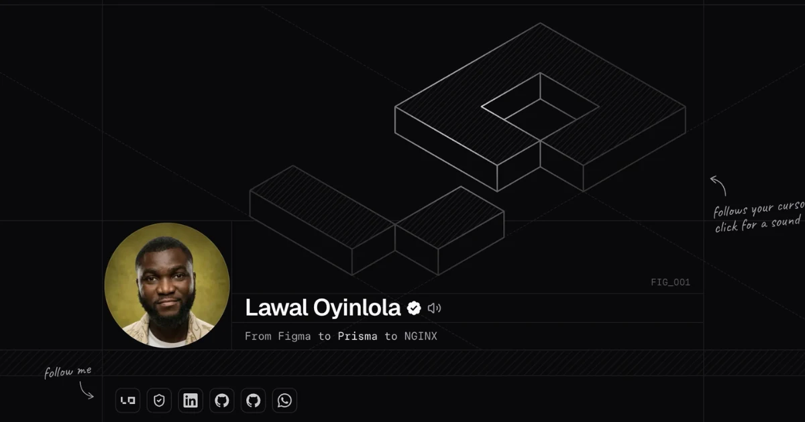

# Lawal Oyinlola — Résumé

A minimalist résumé site for **Lawal Oyinlola**, Frontend Engineer (full-stack capable). It started from the open-source [chanhdai.com](https://github.com/ncdai/chanhdai.com) template and has its own brand, content, and features.

Live: **[resume.lawaloyinlola.com](https://resume.lawaloyinlola.com)** · Main portfolio: **[lawaloyinlola.com](https://lawaloyinlola.com)**

<picture>
  <source media="(prefers-color-scheme: dark)" srcset="public/images/screenshot-dark.webp">
  <source media="(prefers-color-scheme: light)" srcset="public/images/screenshot.webp">
  
</picture>

## Overview

### Stack

- Next.js 16 (App Router, Turbopack)
- React 19 and TypeScript
- Tailwind CSS v4
- shadcn/ui, Radix UI, and Motion
- cmdk for the command palette

### Sections

- **Profile header**: a 3D isometric "LO" mark with a press animation and a key-click sound, plus a greeting that changes with the time of day
- **Overview**: role, location, live local time, and contact details in a two-column grid
- **About**: a short bio and a GitHub contributions graph
- **Stack**: tools in numbered category rows
- **Experience** and **Volunteering**: collapsible roles with durations and skill tags
- **Projects**, **Awards**, and **Certifications**: collapsible items with logos that go from grayscale to color on hover
- **Testimonials**: hidden until the data file has entries
- **Footer wordmark**: "LAWAL" is a palindrome, so the letters flip one at a time as you scroll, and a gradient glow follows the cursor

### Features

- Light and dark themes, with no flash of the wrong theme and no hydration mismatch
- **⌘K command palette** for search, section links, résumé downloads, and brand assets
- **Link previews**: hover an external link to see a screenshot of the page
- One-click **résumé download** (Frontend Engineer and Software Engineer versions, with Google Drive copies as a fallback)
- vCard export
- SEO: [JSON-LD](https://json-ld.org) `ProfilePage` and `Person` schema (`sameAs`, `worksFor`, `alumniOf`, `knowsAbout`), sitemap, and robots rules
- AI-readable: explicit rules for AI crawlers, [`/llms.txt`](https://resume.lawaloyinlola.com/llms.txt), `/llms-full.txt`, and a `.md` route for each section
- Email and phone number encoded against spam bots
- Installable as a PWA

## Development

Read the [Development Guide](./DEVELOPMENT.md) for setup, scripts, and where the content lives.

## License

The code is licensed under the [MIT license](./LICENSE). The license keeps the copyright notice of the original template author and adds mine.

My name, the "LO" mark, the "LAWAL" wordmark, my photos, my voice recording, and my résumé are not part of the license grant. The [trademark and brand policy](./TRADEMARK.md) explains what you can and cannot do with them.

You are welcome to fork this repository. Before you publish your site, remove all of my personal information and replace the branding. The [policy](./TRADEMARK.md#if-you-fork-this-repository) lists the files to change.

## Acknowledgments

- [Nguyen Chanh Dai (@ncdai)](https://github.com/ncdai) for the open-source [chanhdai.com](https://github.com/ncdai/chanhdai.com) template and its design and engineering. If the template helps you too, consider [sponsoring him](https://github.com/sponsors/ncdai).
- The open-source projects this site uses: [React](https://react.dev), [Next.js](https://nextjs.org), [Tailwind CSS](https://tailwindcss.com), [Radix UI](https://www.radix-ui.com), [Motion](https://motion.dev), [shadcn/ui](https://ui.shadcn.com), [Lucide](https://lucide.dev), and the others in `package.json`.
