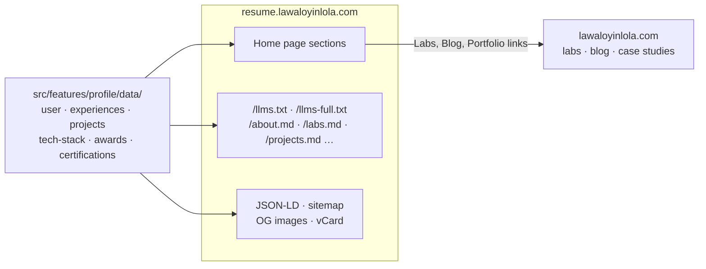
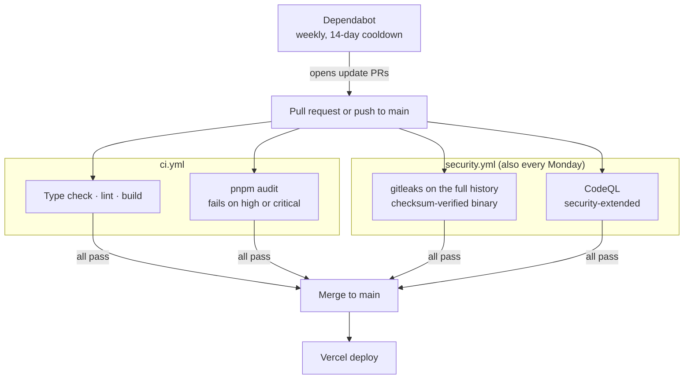

# Lawal Oyinlola · Résumé

A minimalist résumé site for **Lawal Oyinlola**, software engineer and application security: experience, projects, security labs, certifications, and downloadable CVs on one page.

Live: **[resume.lawaloyinlola.com](https://resume.lawaloyinlola.com)** · Main portfolio, labs and blog: **[lawaloyinlola.com](https://lawaloyinlola.com)**

<picture>
  <source media="(prefers-color-scheme: dark)" srcset="public/images/screenshot-dark.webp">
  <source media="(prefers-color-scheme: light)" srcset="public/images/screenshot.webp">
  
</picture>

## Overview

### Stack

- Next.js 16 (App Router, Turbopack)
- React 19 and TypeScript
- Tailwind CSS v4
- shadcn/ui, Radix UI, and Motion
- cmdk for the command palette
- Geist, Paper Mono, and Caveat for type

### Sections

- **Header**: the "LO" mark, links to the labs, blog and portfolio, search, GitHub, and a theme toggle whose dark half turns on each switch
- **Profile**: a 3D isometric "LO" mark with a cursor-following spotlight on its outlines and guides, a press animation, and a key-click sound. Handwritten margin notes point at the interactive parts.
- **Overview**: role, location, live local time, and contact details in a two-column grid
- **About**: a greeting that changes with the time of day, a short bio, and a GitHub contributions graph
- **Stack**: tools in numbered category rows, with Security second
- **Experience** and **Volunteering**: collapsible roles written as result, measure, method
- **Security Labs** and **Projects**: labs get their own section, each written as context, action, result and lesson; projects follow
- **Honors** and **Certifications**: collapsible items with logos that go from grayscale to color on hover
- **Footer wordmark**: "LAWAL" is a palindrome, so the letters flip one at a time as you scroll, and a gradient glow follows the cursor

### Features

- Light and dark themes, with no flash of the wrong theme and no hydration mismatch
- **⌘K command palette** for search, section links, résumé downloads, and brand assets
- **Link previews**: hover an external link to see a screenshot of the page
- One-click **résumé download**, with Google Drive copies as a fallback
- vCard export
- SEO: [JSON-LD](https://json-ld.org) `ProfilePage` and `Person` schema, sitemap, and robots rules
- AI-readable: explicit rules for AI crawlers, [`/llms.txt`](https://resume.lawaloyinlola.com/llms.txt), `/llms-full.txt`, and a `.md` route for each section
- Email and phone number encoded against spam bots
- Installable as a PWA

## How it fits together

All content lives in one folder. Every page section, the machine-readable routes, and the metadata read from it, so a change to one data file updates every place that shows it. Long-form work (lab write-ups and blog posts) stays on the main site, and this site links out to it.

## Security and CI

Nothing reaches `main` without passing the checks below. Third-party actions are pinned to a commit SHA, the workflow token is read-only by default, and the build gets no secrets.

## Development

Read the [Development Guide](./DEVELOPMENT.md) for setup, scripts, and where the content lives.

## License

The code is licensed under the [MIT license](./LICENSE). The license keeps the copyright notice of the original template author and adds mine.

The license covers the code, including the components that draw my brand. It does not give you the right to use my name, the "LO" mark, the "LAWAL" wordmark, my photos, my voice recording, or my résumé. The [trademark and brand policy](./TRADEMARK.md) explains what you can and cannot do with them.

You are welcome to fork this repository. Before you publish your site, remove all of my personal information and replace the branding. The [policy](./TRADEMARK.md#if-you-fork-this-repository) lists the files to change.

## Acknowledgments

- [Nguyen Chanh Dai (@ncdai)](https://github.com/ncdai) for the open-source [chanhdai.com](https://github.com/ncdai/chanhdai.com) template and its design and engineering. If the template helps you too, consider [sponsoring him](https://github.com/sponsors/ncdai).
- [Paper Mono](https://github.com/paper-design/paper-mono) by Paper Design, under the SIL Open Font License 1.1 (see `src/assets/fonts/PaperMono-OFL.txt`).
- UI sounds by [Kenney](https://kenney.nl), CC0, via soundcn.
- The open-source projects this site uses: [React](https://react.dev), [Next.js](https://nextjs.org), [Tailwind CSS](https://tailwindcss.com), [Radix UI](https://www.radix-ui.com), [Motion](https://motion.dev), [shadcn/ui](https://ui.shadcn.com), [Lucide](https://lucide.dev), and the others in `package.json`.
